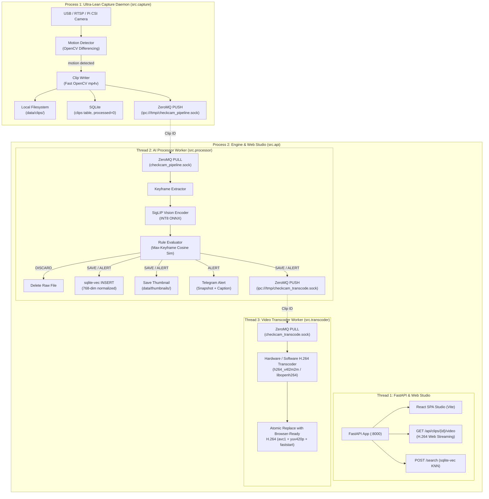

# CheckCam 📹

**Local-first smart security camera system powered by multimodal AI.**

CheckCam transforms an ordinary USB webcam or RTSP camera stream into an intelligent, searchable surveillance system. Instead of burning heavy cloud GPU compute or storing hundreds of hours of empty footage, CheckCam uses **SigLIP zero-shot vision-language embeddings** and **`sqlite-vec` vector search** running 100% locally on CPU.

---

## 🌟 Key Features

- **Motion-Triggered Recording**: Frame-difference motion detector records 5-second MP4 clips only when activity occurs.
- **Zero-Shot Rule Routing**: Automatically routes clips to `DISCARD`, `SAVE`, or `ALERT` using natural language prompts evaluated against SigLIP multimodal embeddings.
- **Local Semantic Search**: Search historical security footage using plain English (e.g. *"a person holding a bottle"*, *"car entering driveway"*, *"someone at the door"*).
- **SQLite + `sqlite-vec`**: 768-dimensional vector embeddings stored directly in SQLite for sub-millisecond nearest-neighbor search.
- **Auto Storage Pruning**: Discarded events (empty rooms, headlights, moving shadows) are physically deleted from disk automatically.
- **Telegram Alert Dispatch**: Delivers instant notification messages with high-confidence event snapshots directly to your Telegram chat.
- **React Studio UI**: Modern dark-themed single-page application served directly by FastAPI with semantic clip search, video playback, and a dedicated **Settings & Rules** tab for live configuration.
- **Dynamic In-DB Settings**: Camera hardware, motion sensitivity, clip duration (max 10s), AI thresholds, and Telegram alerting are stored in SQLite and configurable live from the browser without editing files.
- **Zero-Copy IPC Architecture**: Standalone capture daemon communicates with the in-memory AI engine over non-blocking ZeroMQ IPC sockets.

---

## 🏗️ Architecture



---

## 📋 Prerequisites

- **OS**: Linux (including Raspberry Pi OS Bookworm / Bullseye) / macOS
- **Python**: 3.11+
- **Node.js**: 18+ (for building the React frontend)
- **Camera**:
  - Standard USB Webcam
  - Network RTSP / IP camera stream
  - **Raspberry Pi Camera Module** (Camera Module 2, 3, HQ, Global Shutter via official `Picamera2`)

> [!NOTE]
> When running on a Raspberry Pi with an official CSI camera ribbon, install the system Picamera2 library:
> ```bash
> sudo apt install -y python3-picamera2
> ```

---

## 🚀 Quick Start

### 1. Clone & Set Up Python Environment

```bash
cd CheckCam

# Create virtual environment (allow system site-packages on Pi if using apt picamera2)
python3 -m venv --system-site-packages .venv
source .venv/bin/activate

# Install dependencies
pip install -r requirements.txt
```

### 2. Download Quantized SigLIP ONNX Models

Downloads the INT8 vision and text models (~200 MB total) into `models/`:

```bash
python scripts/download_model.py
```

### 3. Build the React Frontend

```bash
cd frontend
npm install
npm run build
cd ..
```

### 4. Configuration

Edit [config.yaml](file:///home/yefe/Projects/Videos/CheckCam/config.yaml) to configure your camera, thresholds, and optional Telegram bot:

```yaml
camera:
  # Camera Source Options:
  #   - 0, 1, 2...         : USB webcam index
  #   - "picam" or "rpi"   : Raspberry Pi CSI Camera Module (Picamera2)
  #   - "rtsp://..."       : Network RTSP / IP camera stream
  source: 0
  fps: 15
  resolution: [640, 480]

recording:
  clip_duration_sec: 5
  motion_threshold: 25
  min_motion_area_pct: 1.5

rules:
  confidence_threshold: 0.05 # Calibrated for SigLIP raw cosine similarity

telegram:
  enabled: false            # Set true and fill token/chat_id for notifications
  bot_token: ""
  chat_id: ""
```

---

## 🏃 Running CheckCam

CheckCam runs as two lightweight decoupled processes:

### Terminal 1: Start the API Engine & Web Studio
*(Start this first so ZeroMQ binds the IPC socket and loads the SigLIP model into RAM)*:

```bash
source .venv/bin/activate
uvicorn src.api:app --host 0.0.0.0 --port 8000 --reload
```

Open your browser at:  
👉 **[http://localhost:8000](http://localhost:8000)**

### Terminal 2: Start the Motion Capture Daemon

```bash
source .venv/bin/activate
python -m src.capture
```

---

## 🎯 Classification Rules & Actions

Classification rules are stored in SQLite (`checkcam.db`) and dynamically recomputed in memory without restarting the engine.

| Action | Command | Default Prompts | Behavior |
| :--- | :--- | :--- | :--- |
| **`discard`** | `DISCARD` | *"an empty room or hallway"*, *"tree branches blowing"*, *"car headlights"* | Physically deletes the MP4 file to save disk space |
| **`save`** | `SAVE` | *"a person walking"*, *"a dog or cat moving around"*, *"a vehicle pulling in"* | Saves MP4, extracts best-keyframe thumbnail, indexes into `sqlite-vec` |
| **`alert`** | `ALERT` | *"a person with a bottle"*, *"smoke or fire"*, *"delivery driver with package"* | Indexes clip + dispatches Telegram photo alert with exact event frame |

> [!TIP]
> You can add or remove rules directly in the web UI by clicking **Rules** in the navigation header, or via the REST API.

---

## 🔌 REST API Reference

| Method | Endpoint | Description |
| :--- | :--- | :--- |
| `POST` | `/search` | Natural language KNN vector search (`{"query": "...", "limit": 10}`) |
| `GET` | `/api/clips/recent` | Fetch latest camera events with thumbnails and video links |
| `GET` | `/api/clips/{id}/video` | Stream 5-second MP4 video clip |
| `GET` | `/thumbnails/{file}` | Serve cached keyframe thumbnail JPEG |
| `GET` | `/rules` | List all zero-shot classification rules |
| `POST` | `/rules` | Add a rule and immediately reload in-memory embeddings |
| `DELETE`| `/rules/{id}` | Delete a rule and reload embeddings |
| `GET` | `/actions` | List action types (`discard`, `save`, `alert`) |
| `GET` | `/health` | Check engine, DB, and model status |

---

## 📁 Project Structure

```
CheckCam/
├── config.yaml               # System configuration
├── requirements.txt          # Python dependencies
├── checkcam.db               # SQLite database (auto-generated, git-ignored)
├── data/                     # Media storage (git-ignored)
│   ├── clips/                # Saved 5-second MP4 recordings
│   └── thumbnails/           # Best-keyframe JPEG thumbnails
├── models/                   # SigLIP INT8 ONNX models (git-ignored)
│   ├── vision_model_int8.onnx
│   └── text_model_int8.onnx
├── frontend/                 # React SPA
│   ├── src/                  # React components & Vanilla CSS
│   └── dist/                 # Compiled static assets served by FastAPI
├── scripts/
│   ├── download_model.py     # HuggingFace ONNX model downloader
│   └── test_telegram.py      # Telegram bot verification utility
└── src/
    ├── api.py                # FastAPI server & ZeroMQ listener
    ├── capture.py            # Motion-detecting capture daemon
    ├── processor.py          # Keyframe extraction & SigLIP classifier
    ├── embedding.py          # ONNX Runtime inference wrapper
    ├── database.py           # SQLite + sqlite-vec storage manager
    ├── alerting.py           # Telegram notification sender
    ├── zmq_bridge.py         # ZeroMQ PUSH/PULL socket wrappers
    └── config.py             # YAML config schema loader
```

---

## 📄 License

MIT
